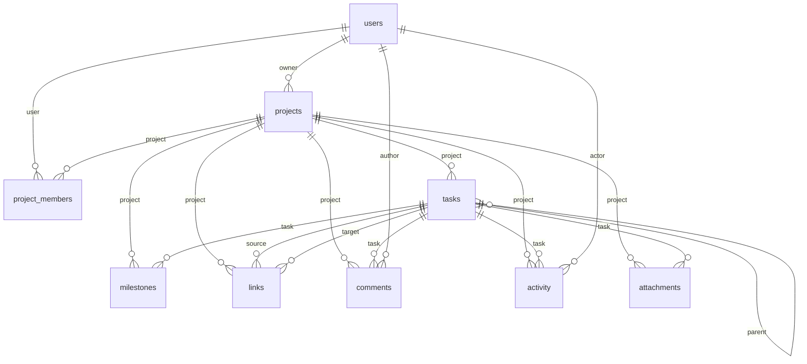

# P3-1 PocketBase Schema 与权限设计

## 1. 结论

P3-1 使用 PocketBase 作为协作模式的服务端。9 个集合覆盖项目、成员、任务、里程碑、依赖、评论、活动、附件和认证用户。权限通过集合 API rules 表达，角色分为 `owner`、`admin`、`editor`、`viewer`。项目成员可读，`editor` 及以上可写，`owner` 和 `admin` 可管理成员，`viewer` 只读。

迁移文件为 `server/pocketbase/pb_migrations/1794268800_init_pmweb_schema.js`。迁移按 PocketBase v0.23 及以上的 JS API 编写，已通过 `node --check`，尚未在真实 PocketBase 实例上执行。运维步骤见 `server/pocketbase/README.md`。

## 2. 范围与前提

本阶段包含：

- 集合、字段、索引和 API rules 的迁移。
- 从 localStorage v3 到服务端字段的映射。
- 权限矩阵、附件访问控制和容量考虑。
- P3-2、P3-3 的字段预留。

本阶段不包含：

- 前端同步模块、离线队列和冲突合并代码。
- 服务端 hook、审计日志写入、分享链接接口。
- 实时订阅和在线状态。
- 真实 PocketBase 启动、迁移执行和端到端测试。
- 任何 `js/**`、`css/**`、`index.html`、`tests/**` 修改。

关键前提：

- PocketBase 记录 ID 是 15 位小写字母和数字。现有客户端 ID 不符合该格式，统一存入 `client_id` 文本字段。
- PocketBase 非 JSON 字段非空，缺省使用类型零值。`text`、`date`、`select`、`relation`、`file` 的零值是空字符串，`number` 是 `0`，`bool` 是 `false`，`json` 是 `null`。
- `select` 字段没有数据库默认值，创建记录时必须提交合法值。
- 每个 base 集合自动带有 `id`、`created`、`updated` 系统字段，`created` 和 `updated` 由 autodate 自动写入，不能通过 API 保留历史时间。
- 需要保留的客户端时间戳使用显式 `created_at`、`updated_at`、`at` 字段。

## 3. 集合关系图



关系规则：

- `project_members` 是项目与用户的唯一关联表，`(project, user)` 唯一。
- `tasks.parent` 是自关联，关闭级联。删除父任务前需要先重挂或删除子任务，否则可能触发外键约束错误。
- `tasks`、`milestones`、`links`、`comments`、`activity`、`attachments` 删除项目时级联删除。
- `comments.task`、`activity.task`、`attachments.task` 删除任务时级联删除。
- `project_members.user` 开启级联，删除用户会删除其成员关系。`projects.owner`、`comments.author`、`activity.actor` 关闭级联，删除用户前需要先转移项目或清理引用。
- 关闭级联后的具体 SQL 行为需要在目标版本实例中验证，删除顺序由同步层保证。

## 4. 集合与字段

### 4.1 users

内置 auth 集合。迁移先查找 `users`，不存在时创建。已存在时补齐 `display_name` 并设置读取和自助更新规则，不改动已有的创建和删除规则。

| 字段 | 类型 | 必填 | 默认 | 索引 | 说明 |
|------|------|------|------|------|------|
| `id` | text | 系统 | 15 位自动 | 主键 | PocketBase 记录 ID |
| `email` | email | 由认证配置 | `""` | 唯一 | 登录身份 |
| `display_name` | text(120) | 否 | `""` | 无 | 界面显示名 |
| `created` | autodate | 系统 | 服务端时间 | 无 | 创建时间 |
| `updated` | autodate | 系统 | 服务端时间 | 无 | 更新时间 |

规则：

| 动作 | 规则 |
|------|------|
| list / view | `@request.auth.id != ""` |
| create | `null`，仅超级用户 |
| update | `id = @request.auth.id` |
| delete | `null`，仅超级用户 |

说明：登录用户可以列出全部用户资料，便于成员选择器。对隐私要求更高的部署应收紧为同项目成员可见，这需要额外的 `@collection` 条件或 hook。

### 4.2 projects

| 字段 | 类型 | 必填 | 默认 | 索引 | 说明 |
|------|------|------|------|------|------|
| `name` | text(200) | 是 | `""` | 无 | 项目名 |
| `description` | text(5000) | 否 | `""` | 无 | 项目描述 |
| `owner` | relation users，单选 | 是 | `""` | `idx_projects_owner` | 创建者，不随成员角色自动变更 |
| `status` | select `active`、`archived` | 是 | `""` | `idx_projects_status` | 创建时必须提交 |
| `import_version` | number，整数 | 否 | `0` | 无 | 导入的 `pmweb_version` |
| `settings` | json | 否 | `null` | 无 | localStorage 的 settings 整体保存 |
| `rev` | number，整数 | 否 | `0` | 无 | 同步修订号，导入时写 1 |
| `updated_by` | relation users，单选 | 否 | `""` | 无 | 最近修改人 |
| `deleted_at` | date | 否 | `""` | 无 | 软删除时间，空表示未删除 |
| `created` / `updated` | autodate | 系统 | 服务端时间 | 无 | 服务端时间 |

规则：

| 动作 | 规则 |
|------|------|
| list / view | `READ(id) && deleted_at = ""` |
| create | `@request.auth.id != "" && @request.body.owner = @request.auth.id` |
| update | `MANAGER(id)` |
| delete | `OWNER(id)` |

### 4.3 project_members

| 字段 | 类型 | 必填 | 默认 | 索引 | 说明 |
|------|------|------|------|------|------|
| `project` | relation projects，单选 | 是 | `""` | 唯一 `(project, user)` | 级联删除 |
| `user` | relation users，单选 | 是 | `""` | `idx_project_members_user` | 级联删除 |
| `role` | select `owner`、`admin`、`editor`、`viewer` | 是 | `""` | `idx_project_members_role (project, role)` | 角色 |
| `invited_by` | relation users，单选 | 否 | `""` | 无 | P3-2 邀请审计预留 |
| `created` / `updated` | autodate | 系统 | 服务端时间 | 无 | 服务端时间 |

规则：

| 动作 | 规则 |
|------|------|
| list / view | `READ(project)` |
| create | 项目创建者自举写入 owner，或现有 `MANAGER(project)` 添加成员 |
| update | `KEEP_PROJECT(MANAGER(project))` |
| delete | `MANAGER(project)` |

自举规则解决创建项目后还没有成员记录的鸡生蛋问题。创建者只能把自己写成 owner，且项目 `owner` 必须是自己。其他成员由已有的 owner 或 admin 添加。

### 4.4 tasks

| 字段 | 类型 | 必填 | 默认 | 索引 | 说明 |
|------|------|------|------|------|------|
| `project` | relation projects，单选 | 是 | `""` | 组合索引前缀 | 级联删除 |
| `client_id` | text(128)，`^[A-Za-z0-9_-]{1,128}$` | 是 | `""` | 唯一 `(project, client_id)` | 保留客户端任务 ID |
| `parent` | relation tasks，单选 | 否 | `""` | `idx_tasks_project_parent (project, parent)` | 自关联，不级联删除 |
| `name` | text(500) | 是 | `""` | 无 | 任务名 |
| `description` | text(5000) | 否 | `""` | 无 | 描述 |
| `assignee` | text(120) | 否 | `""` | `idx_tasks_project_assignee` | 负责人显示名，暂不关联用户 |
| `color` | text(32) | 否 | `""` | 无 | 十六进制色值或空 |
| `start_date` | text(10)，`^\d{4}-\d{2}-\d{2}$` | 否 | `""` | 无 | 纯日期，避免时区 |
| `end_date` | text(10)，同上 | 否 | `""` | 无 | 纯日期 |
| `planned_end_date` | text(10)，同上 | 否 | `""` | 无 | 纯日期 |
| `progress` | number，整数 0 到 100 | 否 | `0` | 无 | 完成百分比 |
| `status` | select `inProgress`、`thirdParty`、`done` | 是 | `""` | `idx_tasks_project_status` | 与客户端一致 |
| `sort_order` | number | 否 | `0` | `idx_tasks_project_sort` | 对应客户端 `order` |
| `gantt_row` | number | 否 | `0` | 无 | 对应客户端 `ganttRow`，0 表示未设置 |
| `estimated_hours` | number，最小 0 | 否 | `0` | 无 | 估算工时 |
| `locked` | bool | 否 | `false` | 无 | 锁定标记 |
| `rev` | number，整数 | 否 | `0` | 无 | 同步修订号 |
| `updated_by` | relation users，单选 | 否 | `""` | 无 | 最近修改人 |
| `deleted_at` | date | 否 | `""` | 无 | 软删除时间 |
| `created` / `updated` | autodate | 系统 | 服务端时间 | 无 | 服务端时间 |

规则：

| 动作 | 规则 |
|------|------|
| list / view | `READ(project) && deleted_at = ""` |
| create | `EDITOR(project)` |
| update | `KEEP_PROJECT(EDITOR(project))` |
| delete | `EDITOR(project)` |

`KEEP_PROJECT` 禁止通过更新把记录迁移到另一个项目，避免使用旧项目的权限写入新项目。

### 4.5 milestones

| 字段 | 类型 | 必填 | 默认 | 索引 | 说明 |
|------|------|------|------|------|------|
| `project` | relation projects，单选 | 是 | `""` | 唯一 `(project, client_id)` 前缀 | 级联删除 |
| `client_id` | text(128)，ID 白名单 | 是 | `""` | 唯一 `(project, client_id)` | 原始里程碑 ID |
| `task` | relation tasks，单选 | 是 | `""` | `idx_milestones_task` | 级联删除 |
| `name` | text(500) | 是 | `""` | 无 | 名称 |
| `date` | text(10)，日期格式 | 否 | `""` | `idx_milestones_project_date` | 纯日期 |
| `status` | select `pending`、`done` | 是 | `""` | 无 | 状态 |
| `rev` | number，整数 | 否 | `0` | 无 | 同步修订号 |
| `updated_by` | relation users，单选 | 否 | `""` | 无 | 最近修改人 |
| `deleted_at` | date | 否 | `""` | 无 | 软删除 |

规则与 `tasks` 相同：成员可读，`editor` 及以上可写。

### 4.6 links

| 字段 | 类型 | 必填 | 默认 | 索引 | 说明 |
|------|------|------|------|------|------|
| `project` | relation projects，单选 | 是 | `""` | 唯一 `(project, client_id)` 前缀 | 级联删除 |
| `client_id` | text(128)，ID 白名单 | 是 | `""` | 唯一 `(project, client_id)` | 原始依赖 ID |
| `source` | relation tasks，单选 | 是 | `""` | `idx_links_project_source` | 前序任务 |
| `target` | relation tasks，单选 | 是 | `""` | `idx_links_project_target` | 后序任务 |
| `type` | select `FS`、`SS`、`FF`、`SF` | 是 | `""` | 无 | 与客户端一致 |
| `lag` | number | 否 | `0` | 无 | 单位天，可为负 |
| `rev` | number，整数 | 否 | `0` | 无 | 同步修订号 |
| `updated_by` | relation users，单选 | 否 | `""` | 无 | 最近修改人 |
| `deleted_at` | date | 否 | `""` | 无 | 软删除 |

规则与 `tasks` 相同。跨项目端点和环检测需要 hook 或同步层校验。

### 4.7 comments

| 字段 | 类型 | 必填 | 默认 | 索引 | 说明 |
|------|------|------|------|------|------|
| `project` | relation projects，单选 | 是 | `""` | 唯一 `(project, client_id)` 前缀 | 级联删除 |
| `client_id` | text(128)，ID 白名单 | 是 | `""` | 唯一 `(project, client_id)` | 原始评论 ID |
| `task` | relation tasks，单选 | 是 | `""` | `idx_comments_task_created (task, created_at)` | 级联删除 |
| `author` | relation users，单选 | 否 | `""` | 无 | 匹配到用户时写入 |
| `author_name` | text(120) | 是 | `""` | 无 | 导入期保留显示名 |
| `text` | text(2000) | 是 | `""` | 无 | 评论正文 |
| `created_at` | date | 否 | `""` | 组合索引 | 保留客户端原始创建时间 |
| `updated_at` | date | 否 | `""` | 无 | 保留客户端原始更新时间 |
| `rev` | number，整数 | 否 | `0` | 无 | 同步修订号 |
| `updated_by` | relation users，单选 | 否 | `""` | 无 | 最近修改人 |
| `deleted_at` | date | 否 | `""` | 无 | 软删除 |

规则：

| 动作 | 规则 |
|------|------|
| list / view | `READ(project) && deleted_at = ""` |
| create | `EDITOR(project) && @request.body.author = @request.auth.id` |
| update | `KEEP_PROJECT(EDITOR(project))` |
| delete | `EDITOR(project)` |

评论作者不能伪造。编辑权限收敛到 `editor` 及以上，作者本人如果是 `viewer` 不能写评论。后续如果需要评论者角色，应在角色枚举中增加 `commenter`。

### 4.8 activity

活动日志是面向用户的变更流，服务端追加式审计在 P3-2 单独建 `audit_log`。

| 字段 | 类型 | 必填 | 默认 | 索引 | 说明 |
|------|------|------|------|------|------|
| `project` | relation projects，单选 | 是 | `""` | 唯一 `(project, client_id)` 前缀 | 级联删除 |
| `client_id` | text(128)，ID 白名单 | 是 | `""` | 唯一 `(project, client_id)` | 原始活动 ID |
| `task` | relation tasks，单选 | 是 | `""` | `idx_activity_task_at (task, at)` | 级联删除 |
| `actor` | relation users，单选 | 否 | `""` | 无 | 匹配到用户时写入 |
| `actor_name` | text(120) | 是 | `""` | 无 | 导入期保留显示名 |
| `field` | text(64) | 是 | `""` | 无 | 变更字段名 |
| `before_json` | json | 否 | `null` | 无 | 变更前值 |
| `after_json` | json | 否 | `null` | 无 | 变更后值 |
| `at` | date | 是 | 服务端时间 | 组合索引 | 客户端时间或导入时间 |

规则：

| 动作 | 规则 |
|------|------|
| list / view | `READ(project)` |
| create | `EDITOR(project) && @request.body.actor = @request.auth.id` |
| update | `null`，仅超级用户 |
| delete | `null`，仅超级用户 |

API 层不提供修改和删除入口，保证普通用户看到的活动流不可篡改。真正的审计防篡改需要 P3-2 的服务端 `audit_log`。

### 4.9 attachments

| 字段 | 类型 | 必填 | 默认 | 索引 | 说明 |
|------|------|------|------|------|------|
| `project` | relation projects，单选 | 是 | `""` | 唯一 `(project, client_id)` 前缀、`idx_attachments_project` | 级联删除 |
| `client_id` | text(128)，ID 白名单 | 是 | `""` | 唯一 `(project, client_id)` | 原始附件 ID |
| `task` | relation tasks，单选 | 是 | `""` | `idx_attachments_task` | 级联删除 |
| `name` | text(255) | 是 | `""` | 无 | 原始文件名 |
| `size` | number，整数 0 到 10485760 | 否 | `0` | 无 | 字节数，10 MB 上限 |
| `type` | text(100) | 否 | `""` | 无 | MIME，小写 |
| `file` | file，单选，最大 10485760 | 否 | `""` | 无 | 受保护文件字段 |
| `checksum` | text(64) | 否 | `""` | 无 | SHA-256 |
| `storage_key` | text(255) | 否 | `""` | 无 | 原 `blobKey` 或外部存储键 |
| `created_at` | date | 否 | `""` | 无 | 保留客户端创建时间 |
| `rev` | number，整数 | 否 | `0` | 无 | 同步修订号 |
| `updated_by` | relation users，单选 | 否 | `""` | 无 | 最近修改人 |
| `deleted_at` | date | 否 | `""` | 无 | 软删除 |

`file` 字段允许的 MIME：PDF、Word、Excel、PowerPoint、纯文本、CSV、PNG、JPEG、GIF、WebP。文件字段设置 `protected: true`，访问受集合 view 规则约束，需要短期 file token。

规则与 `tasks` 相同：成员可读，`editor` 及以上可写。

## 5. 权限模型

### 5.1 角色矩阵

| 操作 | owner | admin | editor | viewer |
|------|-------|-------|--------|--------|
| 读项目、任务、里程碑、依赖 | 是 | 是 | 是 | 是 |
| 读评论、活动、附件 | 是 | 是 | 是 | 是 |
| 创建、修改、删除任务 | 是 | 是 | 是 | 否 |
| 创建、修改、删除里程碑和依赖 | 是 | 是 | 是 | 否 |
| 创建评论、活动、上传附件 | 是 | 是 | 是 | 否 |
| 修改项目名称、描述、状态 | 是 | 是 | 否 | 否 |
| 管理成员和角色 | 是 | 是 | 否 | 否 |
| 删除项目 | 是 | 否 | 否 | 否 |

### 5.2 规则辅助定义

迁移中使用统一构造器生成规则字符串：

```text
READ(p)        = @request.auth.id != "" &&
                 @collection.project_members:actor.user ?= @request.auth.id &&
                 @collection.project_members:actor.project ?= p

EDITOR(p)      = READ(p) && actor.role 属于 owner、admin、editor
MANAGER(p)     = READ(p) && actor.role 属于 owner、admin
OWNER(p)       = READ(p) && actor.role = owner

KEEP_PROJECT(r) = r && (@request.body.project:isset = false ||
                        @request.body.project = project)

ALIVE(r)        = r && deleted_at = ""
```

`p` 的取值：`projects` 用 `id`，其他项目内集合用 `project`。`project_members` 的创建规则额外使用 `@request.body.project`。

`@collection.project_members:actor` 是官方支持的跨集合查询别名。别名保证用户和角色条件落在同一条成员记录上，避免出现「用户 A 是 viewer，用户 B 是 editor」却通过编辑权限的问题。此处依赖官方文档中的别名语义，尚未用真实请求验证。

### 5.3 关键规则原文

项目读取：

```text
@request.auth.id != "" &&
@collection.project_members:actor.user ?= @request.auth.id &&
@collection.project_members:actor.project ?= id &&
deleted_at = ""
```

任务编辑：

```text
@request.auth.id != "" &&
@collection.project_members:actor.user ?= @request.auth.id &&
@collection.project_members:actor.project ?= project &&
(@collection.project_members:actor.role = "owner" ||
 @collection.project_members:actor.role = "admin" ||
 @collection.project_members:actor.role = "editor")
```

成员管理：

```text
@request.auth.id != "" &&
@collection.project_members:actor.user ?= @request.auth.id &&
@collection.project_members:actor.project ?= project &&
(@collection.project_members:actor.role = "owner" ||
 @collection.project_members:actor.role = "admin")
```

### 5.4 规则覆盖不到的不变量

以下约束需要 `pb_hooks` 或同步层实现：

- 每个项目至少保留一个 `owner`。当前规则允许移除最后一个 owner。
- 父任务的 `project` 必须与子任务一致。
- 依赖的 `source`、`target` 必须与依赖记录同项目。
- 依赖不能成环。
- `rev` 不能由客户端任意覆盖，服务端需要递增并校验 `baseRev`。
- 项目 `owner` 与 `project_members` 中 owner 角色的一致性。
- `status` 与日期、进度的业务组合约束。

### 5.5 附件访问控制

`attachments.file` 标记为受保护文件。PocketBase 对受保护文件的访问会走集合的 view 规则，并允许使用短期 file token 填充 `@request.auth.*`。因此只有项目成员能拿到文件。分享链接场景不直接暴露文件 URL，P3-2 应通过服务端签发短期下载地址。

## 6. localStorage v3 字段映射

### 6.1 标识与关系

- `tasks[].id` 写入 `tasks.client_id`。PocketBase 的 `id` 由服务端生成。
- `milestones[].id`、`links[].id`、`comments[].id`、`activity[].id`、`attachments[].id` 同样写入 `client_id`。
- `parentId`、`taskId`、`source`、`target` 需要先建立 `client_id -> PocketBase id` 映射，再写入关系字段。
- 同一项目内 `(project, client_id)` 唯一。不同项目可以复用相同客户端 ID。

### 6.2 任务字段

| 客户端 | 服务端 | 规则 |
|--------|--------|------|
| `id` | `client_id` | 原样保留 |
| `parentId` | `parent` | 空值转 `""`，导入后校验父级存在 |
| `name` | `name` | 必填 |
| `description` | `description` | 可空 |
| `assignee` | `assignee` | 显示名文本 |
| `color` | `color` | `null` 转 `""` |
| `startDate` | `start_date` | `YYYY-MM-DD` 文本 |
| `endDate` | `end_date` | `YYYY-MM-DD` 文本 |
| `plannedEndDate` | `planned_end_date` | `YYYY-MM-DD` 文本 |
| `progress` | `progress` | 四舍五入为 0 到 100 的整数 |
| `status` | `status` | 三个状态原样保留 |
| `order` | `sort_order` | 原样保留 |
| `ganttRow` | `gantt_row` | `null` 转 `0` |
| `estimatedHours` | `estimated_hours` | 可空，负数拒绝 |
| `locked` | `locked` | 布尔值 |

### 6.3 其他实体

| 客户端 | 服务端 | 规则 |
|--------|--------|------|
| `milestones[].taskId` | `milestones.task` | 映射任务记录 ID |
| `milestones[].date` | `milestones.date` | `YYYY-MM-DD` |
| `links[].source` / `target` | `links.source` / `target` | 映射任务记录 ID |
| `links[].type` | `links.type` | `FS`、`SS`、`FF`、`SF` |
| `links[].lag` | `links.lag` | 数字 |
| `comments[].author` | `comments.author_name` | 匹配用户后再写 `author` |
| `comments[].createdAt` | `comments.created_at` | 保留原始时间 |
| `comments[].updatedAt` | `comments.updated_at` | 保留原始时间 |
| `activity[].actor` | `activity.actor_name` | 匹配用户后再写 `actor` |
| `activity[].before` / `after` | `before_json` / `after_json` | 任意 JSON |
| `activity[].at` | `activity.at` | PocketBase 日期格式 |
| `attachments[].blobKey` | `storage_key` | 原键保留，二进制上传到 `file` |
| `attachments[].createdAt` | `attachments.created_at` | 保留原始时间 |
| `settings` | `projects.settings` | JSON 整体保存 |
| `pmweb_version` | `projects.import_version` | 数值 |
| `views[]` | 本次不落库 | 后续迁移补充 |

### 6.4 时间字段

- 客户端 `YYYY-MM-DD` 日期写入文本字段，避免 UTC 偏移改变日期。
- 客户端 ISO 时间在导入脚本中统一转换为 PocketBase 日期格式 `YYYY-MM-DD HH:MM:SS.sssZ`。
- 系统 `created`、`updated` 只表示记录进入 PocketBase 的时间。历史时间使用显式 `created_at`、`updated_at`、`at`。

## 7. 迁移映射

1. 客户端导出 localStorage v3 JSON，包含任务、里程碑、依赖、视图、设置、评论、活动和附件元数据。
2. 服务端预检：ID 唯一、父级存在、依赖端点存在、依赖无环、日期合法、进度范围合法、附件类型和大小合法。
3. 创建 `projects`，写入 `import_version` 和 `settings`，`status` 为 `active`。
4. 创建者写入 `project_members`，角色 `owner`。
5. 按邮箱或显示名匹配 `users`。匹配不到的作者和操作人保留显示名。
6. 按父任务先于子任务的顺序写入 `tasks`，记录 ID 映射。
7. 回填 `parent`，写入 `milestones`、`links`。
8. 写入 `comments`、`activity`，保留原始时间。
9. 写入 `attachments` 元数据，逐个上传二进制并计算 SHA-256。
10. 校验实体计数、字段哈希、引用完整性和附件校验和。
11. 客户端保存 `projectId`、ID 映射、`rev` 和游标，切换为协作模式。
12. 保留导入前的 localStorage 快照，作为短期回滚点。

导入后 `rev` 统一为 1。历史 `activity` 的 `actor` 可以为空，展示时回退到 `actor_name`。

## 8. 索引与容量

### 8.1 唯一约束

- `project_members (project, user)`
- `tasks (project, client_id)`
- `milestones (project, client_id)`
- `links (project, client_id)`
- `comments (project, client_id)`
- `activity (project, client_id)`
- `attachments (project, client_id)`

唯一约束保证重复推送的 `client_id` 不会产生重复记录。软删除记录仍然占用唯一键，删除后重新导入同一 ID 会失败。需要复用 ID 时应硬删除，或在导入前清理墓碑记录。

### 8.2 查询索引

- `projects (owner)`、`projects (status)`
- `project_members (user)`、`project_members (project, role)`
- `tasks (project, status)`、`tasks (project, sort_order)`、`tasks (project, assignee)`、`tasks (project, parent)`
- `milestones (task)`、`milestones (project, date)`
- `links (project, source)`、`links (project, target)`
- `comments (task, created_at)`
- `activity (task, at)`
- `attachments (task)`、`attachments (project)`

API rules 每次请求都会执行 `project_members` 子查询，`(project, user)` 唯一索引是最关键的索引。列表查询通常带 `project` 过滤，复合索引以 `project` 开头。

### 8.3 容量考虑

- SQLite 单写者模型，写入串行。多人高频编辑时应批量推送，减少事务次数。
- 任务、里程碑、依赖和评论按项目分开查询，单项目一万条任务是设计假设，尚未实测。
- `activity` 是增长最快的集合。按项目和时间索引，后续需要归档或按保留周期清理。
- 附件二进制存放在 `pb_data/storage` 或 S3，不进入 SQLite 主表。单文件上限 10 MB，与客户端 `AttachmentMeta.MAX_SIZE` 一致。
- 备份需要同时覆盖数据库和附件目录，恢复点必须一致。
- 受保护文件每次访问都会执行 view 规则，高并发下载需要关注规则查询和 file token 开销。

## 9. P3-2 审计与分享预留

已预留的字段：

| 字段 | 所在集合 | 用途 |
|------|----------|------|
| `rev` | projects、tasks、milestones、links、comments、attachments | 修订号和冲突判断 |
| `updated_by` | 同上 | 最近修改人 |
| `deleted_at` | 同上 | 软删除和同步墓碑 |
| `invited_by` | project_members | 成员邀请审计 |
| `checksum` | attachments | 上传完整性和去重 |
| `storage_key` | attachments | 外部存储键或原 `blobKey` |
| `created_at` / `updated_at` | comments | 保留客户端历史时间 |
| `at` | activity | 活动时间线 |

P3-2 计划新增但不属于本迁移的集合：

```text
audit_log(project, actor, action, entity_type, entity_id,
          before_json, after_json, at, request_id)
share_links(project, token_hash, scope, role, expires_at,
            revoked_at, created_by)
```

`activity` 是用户可见活动流，`audit_log` 是安全审计。两者分开存储。审计由服务端在写事务内生成，客户端没有写权限。

只读分享使用 `viewer` 权限语义。分享会话不返回成员列表、审计日志和附件存储键，附件通过短期签名地址下载。

## 10. P3-3 实时协同预留

- `rev` 和 `updated` 用于乐观并发和增量拉取排序。
- 所有业务集合都有 `project` 关系，SSE 订阅可以按项目过滤。
- `activity.at` 和系统 `updated` 可以作为增量游标的辅助字段。
- `deleted_at` 让删除事件可以增量同步，不需要客户端全量对比。
- 尚未创建 presence、在线心跳或 Yjs 文档集合。字段级 CRDT 仍计划只覆盖 `description` 和评论草稿，任务字段继续由服务端裁决。

## 11. 风险与未验证项

| 项 | 状态 | 影响 |
|----|------|------|
| 迁移未执行 | 只通过 `node --check` | 集合创建顺序和字段选项可能有运行时错误 |
| API rules 未验证 | 依据官方文档编写 | `@collection` 别名、`?=` 语义需要 Dashboard 验证 |
| 最后一个 owner | 规则无法表达 | 可能移除最后一个 owner |
| 跨项目父任务和依赖 | 规则无法表达 | 需要 hook 或同步层校验 |
| `rev` 自动递增 | 未实现 | 客户端可能覆盖修订号 |
| 软删除与唯一索引 | 已知冲突 | 删除后同 ID 重新导入失败 |
| users 可见性 | 所有登录用户可读 | 隐私要求高的部署需要收紧 |
| 级联删除语义 | 未实测 | `cascadeDelete: false` 的删除阻止或置空行为需要验证 |
| 受保护文件 | 未端到端验证 | file token 和 view 规则的组合需要实测 |
| 日期解析 | 未验证 ISO 输入 | 导入脚本应显式格式化 |
| 性能 | 未压测 | 规则子查询、活动量、附件下载都需要实测 |

## 12. 参考

- `docs/design/15-backend-options.md`
- `docs/design/11-collaboration.md`
- `docs/design/12-resources.md`
- `js/store.js`、`js/validate.js`、`js/links.js`、`js/attachment-meta.js`
- PocketBase JS migrations: `https://pocketbase.io/docs/js-migrations/`
- PocketBase API rules and filters: `https://pocketbase.io/docs/api-rules-and-filters/`
- PocketBase files handling: `https://pocketbase.io/docs/files-handling/`
- PocketBase JSVM field reference: `https://pocketbase.io/jsvm/`
